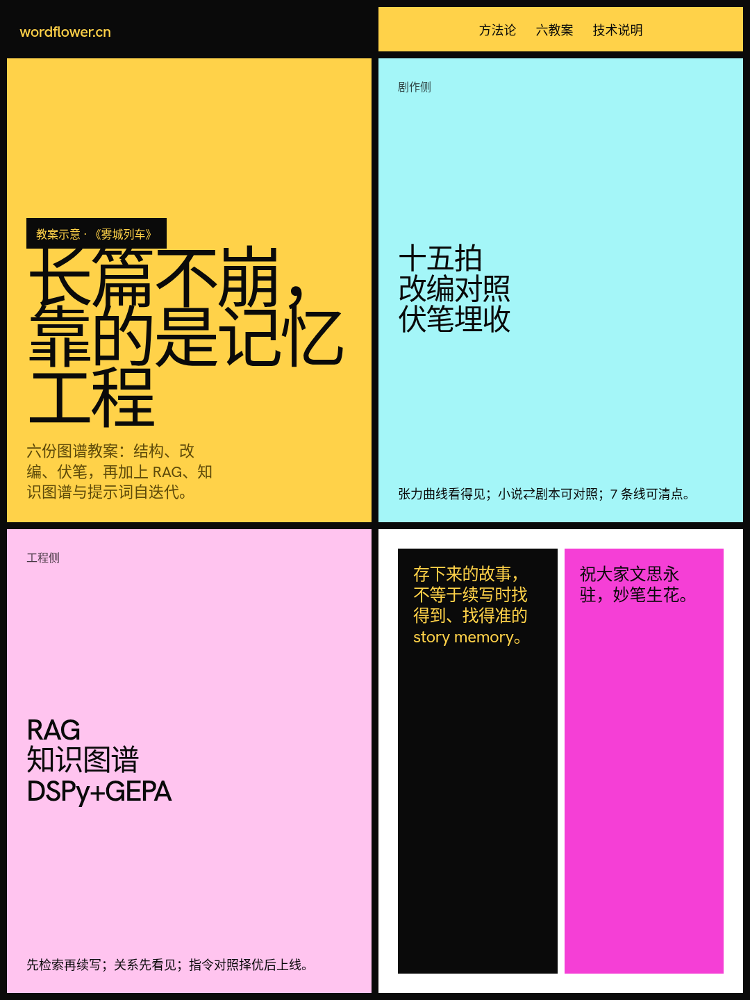

# 百万字长篇不崩，靠六份教案还是模型硬记？

> 存下来的故事，不等于续写时找得到、找得准的 story memory。
> —— 妙笔生花方法论口径

写长篇，难处往往不在单场戏写不出来，而在写到几十万字之后，人物动机、道具状态和伏笔回收仍难稳住。名字没错，人物也可能已经崩；旧道具回来了，设定却被改写；上一章明确否定的事实，隔几章又被当成新信息。

「妙笔生花」把这件事拆成六份可交互教案，并配一份技术说明：剧作侧是救猫咪十五拍、小说⇄剧本对照、伏笔埋收；工程侧是 RAG 记忆检索、知识图谱、DSPy+GEPA。下面按官方虚构示例《雾城列车》讲机制本身。文中数字与相似度均为**教案示意**，不是用户作品实测。

这篇怎么读：

1. 结构三板斧：十五拍、改编、伏笔先把故事骨架立住
2. RAG 五步：续写时如何把记忆叫到桌前
3. 图谱与自迭代：关系网和指令优化怎么接上
4. 限制与判定线：技术说明里比口号更重要的部分

## 剧作侧：节奏、体裁与伏笔先看得见

### 十五拍：张力曲线是地图，不是口号

救猫咪十五节拍把三幕当作底色，把节拍当作心跳。以 110 页剧本为基准：开场画面、主题呈现、铺垫、催化剂、争论进入二幕；中点约在第 55 页，假胜利或假失败让赌注升级；随后坏人逼近、一无所有、灵魂黑夜，再进入三幕、结局与终场画面。

客户端把这套结构做成节拍器与故事弧线规划：AI 为每一章定位叙事节拍，多卷多弧各走一轮。图谱是地图，客户端是导航仪——节奏问题先被看见，才谈得上用工程手段稳住记忆。

### 小说 ⇄ 剧本：改的是表达系统

同一情节，小说可靠叙述与心理，剧本只剩画面、声音与结构。《雾城列车》教案里，怀表贴耳、童年站台，以及「不问了」这句决定，在小说中是内心与回忆；改编到短剧后，被拆成检修车间夜戏、十二年前站台外景，以及收起怀表、把疑问咽回去的动作。

客户端跨体裁改编按「准备阶段对齐总纲、写作阶段逐章逐集推进」组织：设定与人物两端共用，再补场景、心理与画面行。改编不是同义转写，是换一套表达系统。

### 伏笔：难在记得收，也难在可清点

长篇难点常不是埋伏笔，是记得收。《雾城列车》前 60 章教案画了 7 条线：示意已回收 6、待回收 1；最长「父亲的下落」从第 1 章埋到第 57 章收，跨 56 章。另有怀表的秘密、铁皮饭盒、站长的账本、白衣乘客、交接班暗号、母亲的信等线，跨度与状态一眼可见。

状态机是：埋点 → 待回收 → 已回收／悬置。「悬置」允许少数线索跨卷存在，但必须能在时间线中被看见和清点。伏笔管理与 RAG 记忆联动：时间线像体检报告，记忆库像病历本。

> 十五拍、改编与伏笔解决「故事怎么走」；百万字续写还要解决「此刻该回看哪几条证据」。

## 工程侧底座：RAG 把记忆检索做成闭环

### 为什么窗口再大，也救不了百万字？

当全书前情约 41.2 万字、故事到第 41 章中点之后，续写指令可以是：

> 「她终于看清盒盖内侧的那行小字。」——续写这一段，保持与前文一致。

41.2 万字装不进上下文窗口。就算硬塞更多前情，也不等于模型能稳定找出当前场景真正需要的证据。RAG 改变的不是模型记忆容量，而是送进模型的内容组织方式：先从项目记忆库找出最相关的少量条目，再注入上下文。

一次续写的五步：

1. **接收续写指令**：待续写句子、章节位置与一致性要求，共同构成检索线索
2. **向量化**：章节、人物、设定、伏笔逐条入向量库，语义相近即可召回
3. **项目内 top-k 检索**：示意记忆库：人物 23 · 设定 61 · 伏笔 7；top-k=3，且只在当前项目内检索
4. **注入上下文**：命中摘要与原文定位一并送入；正文始终以项目文件为准
5. **生成并自动归档**：新章节与设定变化写回记忆库，供下一章继续检索

| 没有 RAG | 有 RAG |
| --- | --- |
| 主要靠当前指令与眼前少量上下文；重要信息易遗漏、错配 | 续写前先检索项目记忆；把「回忆整本书」改成「取当前证据」 |
| 作者临时补摘要；规模越大越难补全 | 结构化摘要 + 原文定位；可回查，不拿摘要偷换正文 |
| 写坏后再找资料；补救成本高 | 任务内启动检索；点续写的那一秒五步已发生 |

官方未公开该演示三条命中记忆的具体正文，因此不能补写未披露内容。要盯的是机制：每次只取最相关的少量候选，并在写完后自动归档，形成「每章都在场」的项目记忆。

## 知识图谱与 DSPy+GEPA：关系和指令也要工程化

### 知识图谱：写崩关系之前，先看见关系

RAG 主要回答「该回看哪些文本证据」；知识图谱把人物、道具、地点、事件及其关系显式化。《雾城列车》示例节点包括林晚、怀表、未拆的信、铁皮饭盒、雾城北站等，关系覆盖父女、同事、持有、转交、在场等。新实体入文时，客户端依显式提及自动挂边，并与 RAG 共用检索。

可以这样分工：

- **RAG** 找回相关情节与原文片段
- **知识图谱** 提醒谁与谁有什么关系
- **伏笔状态机** 记录埋点到回收或悬置的状态

限制同样写在技术说明里：自动挂边主要覆盖显式提及；隐喻、转述类关系仍需在伏笔视图确认。

### DSPy+GEPA：越用越懂，靠对照而不是自夸

RAG 决定模型该看到什么；DSPy+GEPA 解决创作指令如何持续改进。闭环是：真实作品数据进入离线评估集 → GEPA 读取轨迹与反馈，用自然语言反思重写提示词 → held-out 验证 → 对照择优 → 线上回流。候选不会直接覆盖现行版本；每次变更还要在冻结回归集上检查，避免修好一处、弄坏另一处。

教案里的版本演进与准确率数字是方法演示，不是固定质量承诺。线上对照实验区块则挂实时匿名聚合。技术说明还给出判定线：

| 指标 | 门槛 | 说明 |
| --- | --- | --- |
| 同层样本 | ≥50 / 臂 | 绿／黄／红分层内比较，不达样本量标「样本不足」 |
| 均值差 | ≥0.05 | 或降幅差 ≥0.03 才判显著 |
| 遥测 | 无正文 | 不含标题、人名与作品内容 |

常见误解：

- ~~窗口更大就会记住百万字~~ → 窗口解决不了检索与证据组织；41 万字前情仍要项目内召回
- ~~有了 RAG 就不会崩~~ → 命中质量依赖埋点密度与冷启动；多义召回仍需事实核查兜底
- ~~自动挂边等于关系全对~~ → 主要覆盖显式提及；隐喻与转述要人工确认
- ~~指令越改一定越好~~ → 必须 held-out 与对照择优；候选不直接覆盖现行版本

## 限制披露与作者动作

已知限制（技术说明）：

1. **埋点密度**：未入库的信息无法被检索命中 → 先持续维护人物／设定／伏笔
2. **冷启动**：前几章可用历史少 → 不要把早期表现当成终局能力
3. **多义召回**：top-k 可能选错弱相关条目 → 生成侧核查是补救，不是零错误保证
4. **离线≠线上误解**：离线领先不保证线上体验领先 → 最终裁决以对照实验为准

写长篇时先问自己：

- 人物设定伏笔进库了吗？没有埋点，再强的模型也召不回
- 每次续写有没有把相关证据叫到桌前？看的是检索与注入，不只是窗口长度
- 写完后新记忆归档了吗？闭环断在归档，下一章就会漂
- 关系与伏笔状态能清点吗？图谱和埋收时间线是体检，不是装饰

> **最终判断**：长篇稳定靠的是可检查的记忆工程，不是模型「硬记」。六份教案把结构、改编、伏笔、检索、关系与指令优化摊开；技术说明把判定线与限制写清楚。作者真正要盯的，是记忆库是否完整、证据是否到位、状态是否可清点。

方法示意基于《雾城列车》；不含用户作品。

下一步：先打开方法论，把六份教案过一遍。完整图谱与技术说明见 https://wordflower.cn/methodology ；产品与下载入口 https://wordflower.cn 。祝大家文思永驻，妙笔生花。

我是 妙笔生花，做 AI 写作助手，帮作者稳住长篇网文与剧本的记忆与结构。

如果你觉得今天这篇有收获，欢迎点赞、在看、转发三连，我们下篇见。
