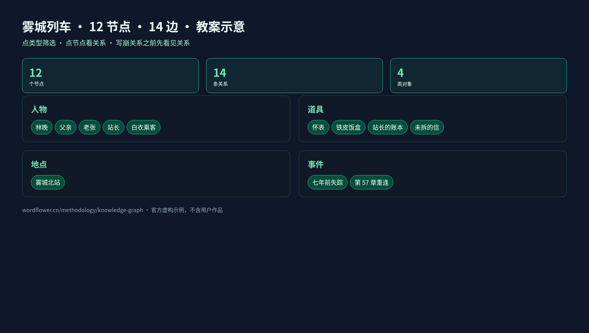
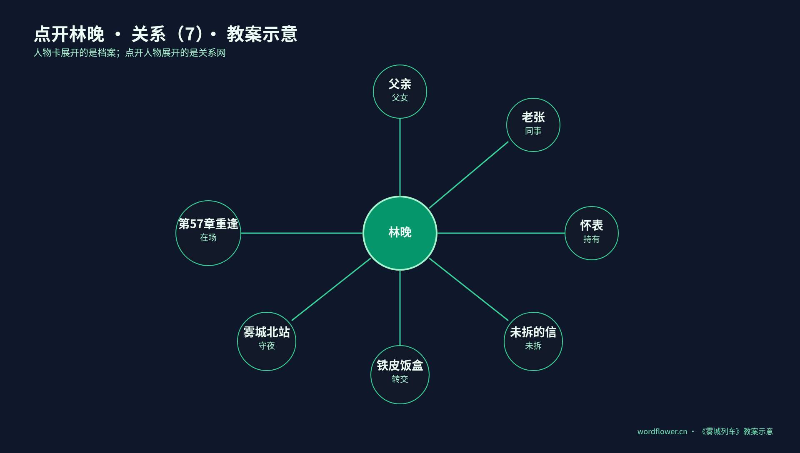
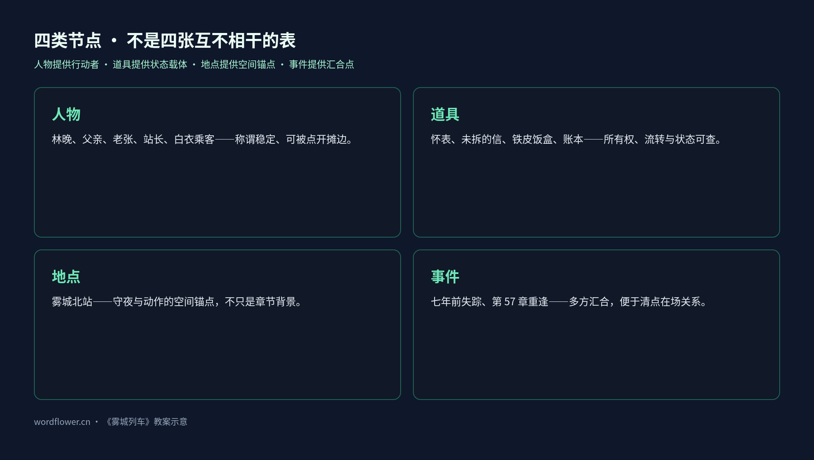
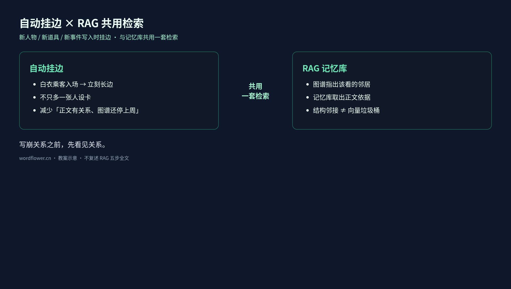

# 12 个节点 14 条边：长篇关系不崩靠知识图谱，不是人设备忘录

> 写崩关系之前，先看见关系。
> —— 妙笔生花 · 知识图谱教案口径

长篇写到后半，读者常比作者更清楚谁和谁有过节、某件道具在谁手里、某次重逢牵动哪些旧线。人设卡写得再细，也常只是一叠彼此没有连线的卡片。

妙笔生花用可交互的知识图谱教案演示这件事：把虚构示例《雾城列车》的人物、道具、地点与事件画成一张网——点任何节点，关系一眼摊开。下文节点数、边数与摘句均为**教案示意**，只讲机制，不是用户作品实测，也不等于产品性能指标。

阅读顺序：

1. 先看一张网里有什么：12 个节点、14 条关系、4 类对象
2. 再点开林晚，看 7 条边如何把「档案」变成「关系」
3. 弄清为什么道具和事件也必须是节点
4. 看自动挂边如何与 RAG 共用检索（轻点接口，不复述检索五步）
5. 对照四种关系写崩模式，做自检

## 人设表能记人，却接不住关系网

人物表通常最先填满：姓名、身份、性格、经历。写到中段再补地点、道具、事件。资料有用，但默认仍是**并列的卡片**。

林晚的人设卡可以写得很清楚：主角，夜班检车员，七年前父亲失踪后留在雾城北站。只看这张卡，作者知道她是谁，却不能立刻回答：

- 她和老张现在是什么工作关系？
- 怀表是否仍由她持有？
- 「未拆的信」处在什么状态？
- 铁皮饭盒经过怎样的转交？
- 「第 57 章重逢」现场有谁在场？

答案若全靠翻设定、搜章节、凭印象拼接，关系越多越费时。常见翻车不是「完全没写过」，而是**写过，却看不见连接**。

知识图谱补的是连接层：节点可按人物 / 道具 / 地点 / 事件筛选，边带关系类型，点节点看关系。人设表回答「是谁」；图谱还要回答「和谁、凭什么、此刻怎样连着」。

## 一张网看什么：12 · 14 · 4

教案《雾城列车》最小样本给出三个结构计数（均为示意）：

| 计数 | 含义 |
| --- | --- |
| **12 个节点** | 可识别、可追踪的对象 |
| **14 条关系** | 连接两个节点的边 |
| **关系类型 4 类** | 筛选与理解边的语义维度（页面按人物 / 道具 / 地点 / 事件做类型筛选） |

公开演示里能直接点到的节点名包括：林晚、父亲、老张、站长、白衣乘客、怀表、铁皮饭盒、站长的账本、未拆的信、雾城北站、七年前失踪、第 57 章重逢。关系谓词示例有：父女、同事、持有、未拆、转交、守夜、留下、当事人、在场、值班、驻守、保管、出现在等。

重点不在背表，而在用法：**先筛选类型，再点节点摊开边**。不必把十二个名字同时装进工作记忆，沿当前章节碰到的对象往外读一层即可。

## 点开林晚：七条边一眼摊开

教案给林晚标了 **关系（7）**。点开后出现的不是小传，而是七条可核对的边：

| 关系 | 对象 | 续写时立刻用得上的信息 |
| --- | --- | --- |
| 父女 | 父亲 | 亲缘主线仍在场，不是背景一句带过 |
| 同事 | 老张 | 值班对话、交接班有既有协作基础 |
| 持有 | 怀表 | 道具可进入动作与情绪，所有权清楚 |
| 未拆 | 未拆的信 | 状态本身是戏剧压力：拆或不拆都要付代价 |
| 转交 | 铁皮饭盒 | 流转关系：东西怎么到她手上、还会交给谁 |
| 守夜 | 雾城北站 | 空间锚点：她为何「应该」出现在北站夜班 |
| 在场 | 第 57 章重逢 | 事件锚点：重逢现场她是当事人之一 |

它可与伏笔教案里的「第 57 章回收」对接，但职责不同：伏笔时间线回答**一条线是否仍欠读者答案**；知识图谱回答**重逢事件节点上谁与什么连着**。一个管呼吸长度，一个管结构邻接，两套视图不宜互相替代。

人物卡展开的是一份档案；点开人物展开的是一段关系网络。

## 为什么道具和事件也必须是节点

如果只做「谁认识谁」的社交图，不过是通讯录升级版。长篇更容易崩在人物如何通过**道具、地点、事件**发生联系。

**人物**提供行动者与称谓稳定性（林晚、父亲、老张、站长、白衣乘客）。若把所有信息塞进人物小传，道具和事件就无法独立追踪。

**道具**保存所有权、流转与状态。怀表对应「持有」；未拆的信把「未拆」写成可查询的状态，而不是形容词；铁皮饭盒强调「转交」；站长的账本提示保管与职责。人物关系没变，道具状态可能已变——只记「林晚认识老张」，仍不知道饭盒在谁手里。

**地点**提供空间锚点。雾城北站既是守夜地点，也是许多动作的默认舞台。没有地点节点，「她值夜班」只是设定句；有了「守夜 → 雾城北站」，续写时才好检查人物该不该出现在这里。

**事件**提供时间与多方汇合点。「七年前失踪」把父亲线钉在可引用的事件节点上；「第 57 章重逢」让在场人物与相关道具挂到同一汇合点。没有事件节点，人物往往只剩静态「认识」；有了事件节点，同一夜、同一现场才能清点。

一句话收束：

> 人物提供行动者，道具提供状态载体，地点提供空间锚点，事件提供时间与因果汇合点。

## 自动挂边：新角色入场，网就长出一条边

人工维护关系网当然可以；但每写一章都重抄节点表，很快又会变成没人愿意碰的台账。教案对应的客户端能力是：创作过程中持续维护项目知识图谱——**新人物、新道具、新事件写入时自动挂边**，并**与 RAG 记忆库共用一套检索**。

自动挂边要对付的是「正文已写出关系，图谱还停在上周」。白衣乘客入场，不应只多一张人设卡，而应立刻挂上他与车站、某次出现或某件道具的边；否则后文再写他，只能靠搜旧文碰运气。

与 RAG 的接口可以想成分工，而不是互相吞并：

- **图谱**：结构邻接——谁和谁有边、边是什么类型、节点属哪一类；
- **RAG 记忆库**：证据召回——续写时注入相关原文与设定片段。

图谱指出该看哪些邻居；记忆库取出相关正文依据。RAG 教案里的检索五步此处不展开；只需记住：**共用检索，不等于把图当成又一个向量垃圾桶**。图要可筛选、可点开；记忆要可引用、可归档。

手感上的变化通常是：写新角色少一次「回头补设定」；写重逢与道具交接时先看邻接再开写，假关系会更早暴露。

## 四种关系写崩模式

下面四种模式，方便写崩前对号入座。

### 1. 假边

正文只出现过并肩站台，图谱却标成「父女」「同盟」之类强关系。读者会觉得「怎么突然这么亲」，因为边类型超过了正文证据。  
**对策**：边类型跟正文可核对的动作走；证据不足就用更弱的谓词，或标待确认，不要先堆戏剧性标签。

### 2. 孤儿节点

新建了「站长的账本」「白衣乘客」，却没有任何边。节点在列表里，续写时仍像不存在。  
**对策**：新节点入场至少要有**一条边**；自动挂边要解决的就是「建了卡、没入网」。

### 3. 类型混用

把「未拆」写成人物性格，把「第 57 章重逢」只当章节标题而不做事件节点，或把地点写进人设备注永不升格。筛选一失效，就只剩全文搜索。  
**对策**：人物 / 道具 / 地点 / 事件各归其类；状态类信息优先挂在道具或事件上。

### 4. 只建卡不挂边

最像人设备忘录的失败：资料很多，网是空的。世界看起来丰富，真正写作时仍靠记性。  
**对策**：把「可见的边」当成健康指标——不是边越多越好，而是关键对象被点开时不应空白。

## 作者自检清单（可直接贴进项目笔记）

1. 当前卷活跃的主要人物，点开后是否至少能看到与主线相关的边？
2. 关键道具是否有独立节点，且持有 / 转交 / 保管 / 未拆等状态可查？
3. 即将写的重逢或冲突，是否已有（或应有）事件节点，而不是只靠章节号？
4. 新角色入场后，是否在正文写出关系的同时完成挂边，而不是留到「有空再补设定」？
5. 续写前：先看图谱邻接，再让 RAG 取证据——两者是否分工清楚？

## 结语

长篇后半比的不是谁的人设字段更全，而是关系结构是否仍可导航。12 个节点、14 条边只是教案里的最小标本：演示「先看见关系」，不是炫耀一张巨图。

把通讯录升级成可筛选的网，让新角色入场就挂边，并与记忆检索共用入口——写崩关系的概率会下降。原因通常不是模型突然更聪明，而是作者能看见自己写过的连接。

继续阅读：

- 知识图谱教案：https://wordflower.cn/methodology/knowledge-graph
- 妙笔生花：https://wordflower.cn
