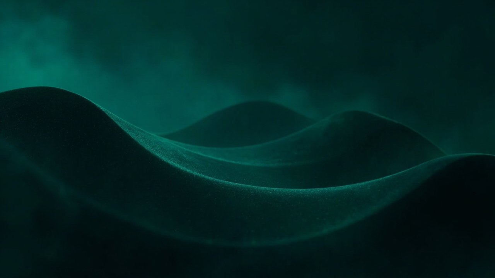
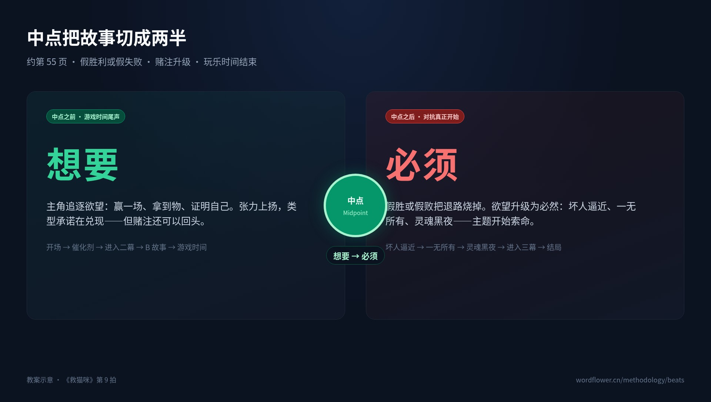
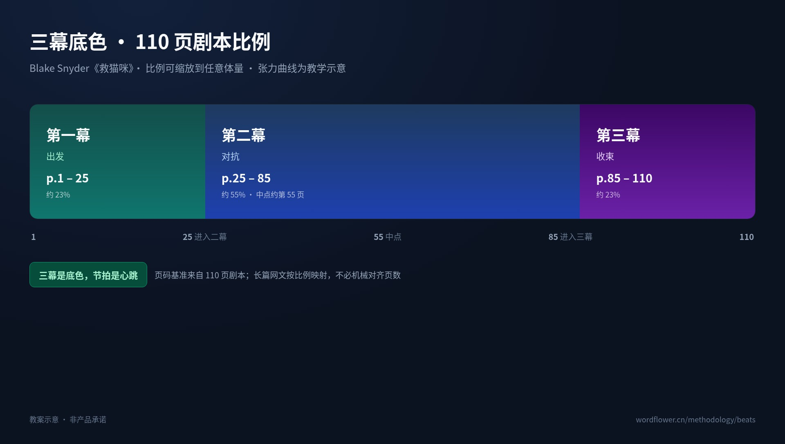
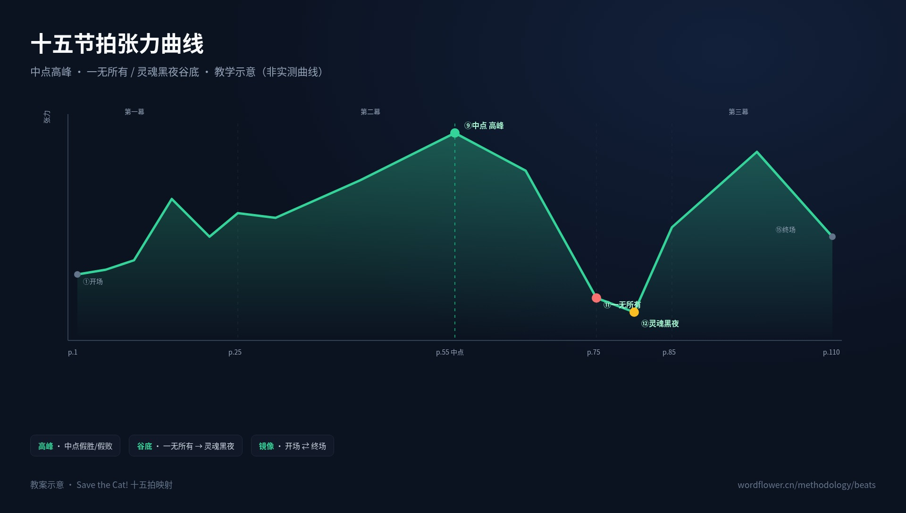

# 中点把故事切成两半：十五节拍张力曲线，不是大纲检查表

> 中点不是第九个等待打钩的栏目，而是整条故事压力方向改变的一刀。前半程，主人公还在权衡「要不要去」；到了中点，一次假胜利或假失败让他别无选择，故事从「想要」跨入「必须」。看懂这条分界线，十五节拍才是推动因果与张力的方法，而不是十五个依次填满的格子。

## 一、中点是一道分水岭，不是一个反转标签

Blake Snyder《救猫咪：电影编剧宝典》（Save the Cat!, 2005）里的中点，约落在第 55 页。张力在这里抵达高峰：主人公可能赢得想要的东西，也可能遭遇一次失败，但无论表面结果如何，赌注都会升级，行动的性质随之改变。

关键区别在于，「想要」只是目标，「必须」却是无法轻易退出的处境。前半程，观众还会问主角是否值得冒险；中点之后，问题变成：既然已经走到这里，还能怎样抽身。中点切割的不仅是篇幅，也是主角与观众的关系——此前我们在旁观犹豫，此后我们开始担心他会不会撑不住。

官方虚构示例《雾城列车》可作轻量参照（以下均为**教案示意**）：主人公起初只想取得通行证，离开常年被浓雾封锁的城市；中点若让他拿到通行证，却因新的危机被迫留下救下一车乘客，那么通行证带来的就不是自由，而是新的责任。这里真正翻转的并非通行证本身，而是主人公对目的地的理解。

中点也不等于突然塞入一个陌生反派或大型事故。检验标准是：这一事件之后，主人公还能否回到中点之前那个稳定状态？如果答案仍是「可以」，那它多半只是情节，不是分水岭。

## 二、三幕底色与 110 页比例：页码是坐标，不是配额

以 110 页剧本为基准，三幕的结构范围如下：

| 幕 | 页码范围 | 结构职责 |
|---|---:|---|
| 第一幕（出发） | p.1–25 | 建立出发前的世界，并把故事推过门槛 |
| 第二幕（对抗） | p.25–85 | 在新规则中承受对抗，并抵达精神转折 |
| 第三幕（收束） | p.85–110 | 用答案完成决胜，收拢伏笔并形成终局 |

这套比例适用于任意体量。短篇可以把约第 25 页理解为第一次重大越界，把约第 55 页理解为中点转折，把约第 85 页理解为答案成形；长篇、卷制或连载则按相对位置缩放。它提供的是结构坐标，不是要求每个项目恰好写成多少章。

同样重要的是，下面的张力曲线属于**教学示意**：它用上升、回落、触底与反弹呈现节拍之间的职责关系，并非作品质量评分，也不是对实际读者紧张程度的精确测量。完整方法见 [救猫咪 · 十五节拍图谱](https://wordflower.cn/methodology/beats)。

## 三、沿着张力读懂十五拍

### 1. 前半程：从日常状态走向不可逆选择

第 1 页的 **开场画面（Opening Image）** 承担平稳张力的职责：展示世界、基调，以及主角改变之前的样子。它还要与终场画面互为镜像，因此开场不能只是一幅漂亮风景，而应留下可以回看的对照基线。

约第 5 页的 **主题呈现（Theme Stated）** 同样保持平稳。配角会在无意间说出作品正在谈论什么，但主角此时未必理解。这句话先像种子埋下，直到灵魂黑夜才被听懂。

第 1–10 页的 **铺垫（Set-Up）** 负责交代主角、阵营与缺陷，同时让日后要被唤醒、牺牲或治愈的东西提前露面。铺垫不是把设定讲完，而是让后面的变化拥有可以识别的材料。

约第 12 页的 **催化剂（Catalyst）** 带来第一次骤升：日常被打破，故事正式点火。第 12–25 页的 **争论（Debate）** 则让张力回落，主角反复犹豫「要去吗」。这段时间也是观众认同主角的最后机会；如果连他的动机都无法成立，跨过门槛只会显得像作者强行推人。

约第 25 页的 **进入二幕（Break into Two）** 再次抬升张力。主角跨过门槛，进入规则颠倒的新世界。真正的分界不只是物理地点变了，而是主角看世界的方式已经不同。

约第 30 页的 **B 故事（B Story）** 与主线并行展开，可以是爱情线，也可以是导师线。它与 A 故事分工清晰：**A 负责打，B 负责悟**；第三幕的答案往往会先在这里排练。

第 30–55 页的 **游戏时间（Fun and Games）** 持续上扬，兑现类型承诺：悬念、爽点与奇观都应在这里出现。若这一段只剩赶路，类型趣味就会提前被耗尽。

### 2. 中点：假胜利或假失败，让「想要」变成「必须」

约第 55 页的 **中点（Midpoint）** 是整条曲线的第一座高峰。主人公可以取得一次假胜利，也可以遭受一次假失败；无论结果朝哪个方向倾斜，赌注都必须升级，玩乐时间结束。

假胜利的危险，在于主角得到了原先想要的东西，却因此承担了更大的责任；假失败的危机，则在于想走的路被截断，主角只能在更高赌注下继续。两者都在完成同一件事：把可选项变成不可选项。

因此，中点之前是「想要」，之后是「必须」。这并不是要求后半程持续增加苦难，而是要求改变主角行动的约束条件。中点之后若还能轻松回到旧生活，所谓「必须」就只停留在台词里。

### 3. 后半程：从外部收紧到内部答案

第 55–75 页的 **坏人逼近（Bad Guys Close In）** 开始施压，而且是内外双向收紧：外部阻力逼近，主角内部的问题也开始反噬。前半程的缺陷若没有继续发挥作用，逼近就只剩情节安排，难以形成真正危机。

约第 75 页的 **一无所有（All Is Lost）** 让张力坠底。它不是普通的坏消息，而是最痛的一击，并且必须有东西真正死去——Snyder 称之为「死亡的气息」，哪怕死去的只是一段关系、一个信念。只有损失已经不可逆，后面的反弹才有重量。

第 75–85 页的 **灵魂黑夜（Dark Night of the Soul）** 位于张力最低处。主角哀悼、反思，直面主题；第 2 拍主题呈现时说出的那句话，也在这里被真正听懂。最低张力不等于故事停摆，恰恰是人物内部完成重组的阶段。没有黑夜，黎明只是换了个布景。

约第 85 页的 **进入三幕（Break into Three）** 带来反弹。A 故事与 B 故事碰撞出答案，前面积累的关系、导师与主题不再各自运行，而是开始共同解决问题。

第 85–110 页的 **结局（Finale）** 完成决胜：主角用新学到的真理，打赢旧世界的问题。这里尤其值得注意，**结局是证明，不是打斗**。终局可以出现动作场面，但真正决定胜负的，是主角是否已经用行动证明自己理解了主题。所有伏笔也应在这里收拢，让结尾同时回收主题、关系与人物选择。

第 110 页的 **终场画面（Final Image）** 负责张力收束。它呈现改变之后的「之后」，并与开场画面形成镜像：开场回答「主角原来是谁」，终场回答「他最终成为谁」。二者若不能对照，故事即使结束，也没有完成圆环。观众需要的不是解释，是一眼能认出的前后对照。

## 四、为什么填满格子，仍可能写出一部平的故事

节拍表与张力曲线的根本差异，在于前者主要记录名称，后者主要记录变化。一个章节被标成「催化剂」，只证明位置上出现了这个名称；如果事件发生后，主角的处境、选择和风险都没有改变，格子虽然填满，故事依然平直。

最常见的误写，是把情节清单当作节奏。情节清单追问「接下来发生什么」，张力曲线追问「这一拍改变了什么，以及为什么下一拍会更紧或更松」。事件数量并不等于压力：一次失败的对话可以制造强烈张力，一段冗长追逐也可能只剩噪音。

另一个误写，是把低张力理解成无事发生。实际上，主题呈现负责埋下等待回响的种子，争论负责暴露主角的犹豫，灵魂黑夜负责完成内在转变。低张力段落如果改变了理解与承诺，依然是不可替代的结构部件。

阅读曲线时，可以只抓住三个连续问题：

1. 这一拍发生前，人物想要什么、承受什么？
2. 这一拍迫使人物作出什么选择或失去什么？
3. 这一拍结束后，什么已经不能轻易恢复原状？

这三个问题把「有无这个节拍」转换成「状态有无发生变化」。节奏职责关注因果是否咬合，情节清单则容易只关注场面是否接续。页码只能提示位置，真正需要检查的是压力方向能否完成一次有效变向。

## 五、把节拍器变成导航，而不是替作者开处方

在长篇生产中，节拍最怕被平均分配：每章一个动作，每卷一个高潮，看似整齐，却看不见因果如何穿过人物。妙笔生花公开的客户端能力包括：救猫咪 15 拍节拍器与故事弧线规划开箱即用；AI 为每一章定位叙事节拍；多卷多弧各走一轮；百万字连载的节奏依然张弛有度。

「定位」比「贴标签」多一层工作：它把章节放回整条故事弧线，判断它此刻承担的是铺垫、转折、施压还是收束。多卷多弧可以各走一轮，解决的是不同层级节奏相互覆盖的问题；百万字连载需要的则不是持续加码，而是让张与弛在更长距离里保持关系。

这正是「图谱是地图，客户端是导航仪」的含义。地图呈现节点、路径与章节之间的联系，导航仪帮助写作者确认自己在哪里、下一站该承担什么职责。但导航仪不替驾驶者决定目的地，正如节拍器不能替作者制造人物动机。它提供检查因果与位置的工具，最终选择仍要回到故事本身。

## 六、结语：先找分水岭，再安排每一站

使用十五节拍时，应先回答中点如何把「想要」改成「必须」，再回看前半程为何走向它、后半程为何无法退回。这样安排，节拍就不再是任务清单，而是张力的因果链：开场留下镜像，主题埋下种子，中点改变约束，灵魂黑夜听懂主题，结局以行动完成证明。

完整教案见：[救猫咪 · 十五节拍图谱](https://wordflower.cn/methodology/beats)。同系列接口还包括体裁改编、伏笔埋收与多端同步——改编时先重估节奏，伏笔则要在结局完成收拢。
