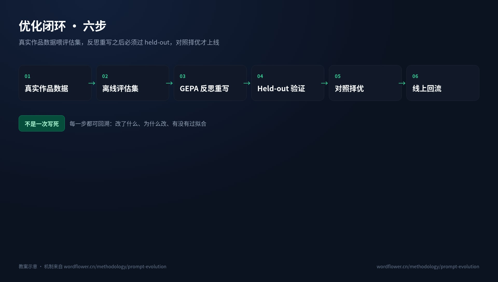
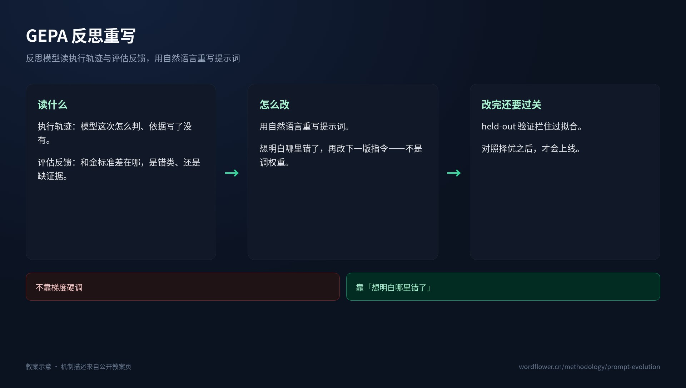
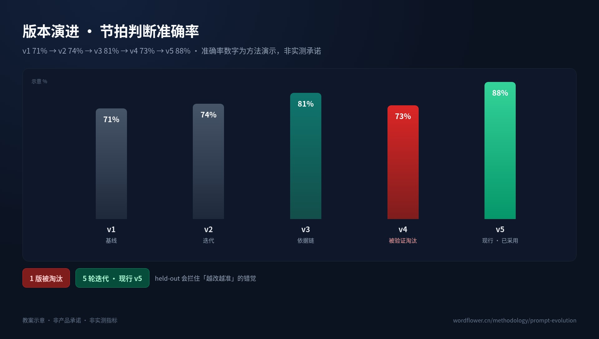
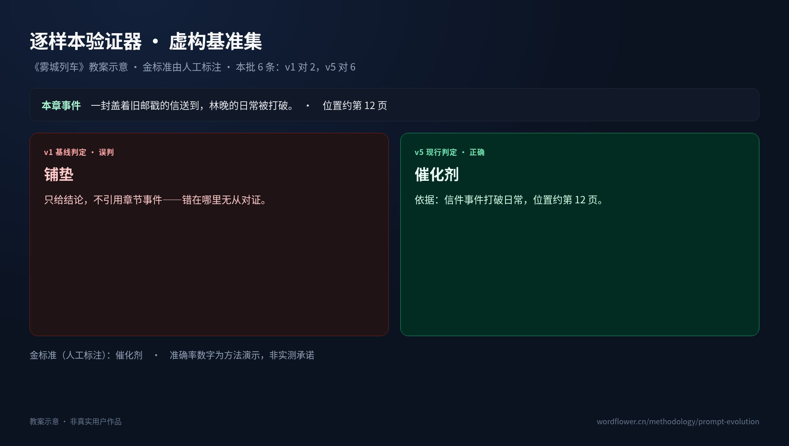

# 提示词不是一次写死的：GEPA 靠反思重写，不是靠梯度硬调

> 提示词不是一次写死的。真正有效的提示词自迭代，不是拿梯度对参数做几次“硬调”，也不是每改一版就默认更准；它让模型读取执行轨迹与评估反馈，用自然语言反思后重写指令，再由 held-out 验证拦下过拟合，最后通过线上对照择优。简单说，关键在于系统能否通过验证而非单纯依赖修改次数的多少来决定哪一版真正该留下。

## 1. 创作指令为什么不能一次写死

如果把创作提示词理解成一段交付后就不再变化的说明书，那么它最多只能表达“希望模型怎样写”，却无法回答“这次究竟错在哪里”。

真实作品会不断暴露新的问题：同一类场景可能被识别成不同功能，结论可能没有依据，规则之间还可能互相冲突。一个只在初始版本里写过的提示词，即使措辞再严密，也缺少根据失败样本修订自己的机制。复杂创作指令通常更像一份需要持续维护的规则文档，超出了静态文案的范畴。

更关键的是，“改写”不能等同于“随手加一句”。新增规则可能修补一个样本，也可能覆盖旧规则。改写后的版本究竟保留了哪些能力、增加了什么判断依据、是否仍能处理未见过的输入，都必须经过可验证的比较。

提示词自迭代要解决的，是让自然语言规则能被评估、修订和淘汰。只把提示词写得更像一份优化说明书，解决不了这个问题。

## 2. 优化闭环六步：数据如何变成可验证的改写

完整闭环有六个环节，名称与顺序固定：

**真实作品数据 → 离线评估集 → GEPA 反思重写 → Held-out 验证 → 对照择优 → 线上回流**

| 环节 | 具体作用 |
|---|---|
| 真实作品数据 | 提供来自实际创作的问题与反馈，避免只在抽象示例上优化。 |
| 离线评估集 | 把作品数据整理成可重复执行的评估样本，让提示词修改有明确参照。 |
| GEPA 反思重写 | 读取执行轨迹与评估反馈，用自然语言找出问题并重写提示词。 |
| Held-out 验证 | 检查候选提示词在未参与改写的样本上是否仍然有效，拦住过拟合。 |
| 对照择优 | 比较候选版本与现行版本，只让验证表现更好的方案进入线上。 |
| 线上回流 | 将真实使用结果继续送回数据侧，使下一轮优化建立在新的作品数据上。 |

这张图最容易被忽略的部分，是“反思重写”前后都存在约束。反思模型不是拿到反馈后随意扩写一版新提示词；它的修改需要经过 held-out 验证，再与现行版本对照。也就是说，自然语言改写负责提出候选方案，验证与对照负责决定候选方案有没有资格上线。

这也解释了为什么“越改越准”是一种错觉。如果候选版本只针对已被反思的样本调整，局部指标可能上升，但在未见样本上的表现反而下降。held-out 验证的作用，就是把这种表面进步与真实改进区分开。

在方法页的版本视图中，可以点选不同版本，查看每一轮究竟改了哪些提示词；底部则挂载线上对照实验的真实聚合数据。版本差异与线上结果被放在同一条链路里：前者解释修改过程，后者检验最终表现，而不是只给出一个脱离上下文的最优版本号。

## 3. GEPA 反思重写：读轨迹与反馈，用自然语言改提示词

GEPA 处理的是提示词本身。反思模型读取执行轨迹与评估反馈，先用自然语言说明哪里出了问题，再把诊断转化为新的提示词文本。

这里的“轨迹”用于回看实际执行过程，“反馈”用于指出结果与目标之间的偏差。二者结合后，改写不再只是“再写得详细一点”，而应当落到具体规则：缺少什么判断条件，哪条规则缺少裁决顺序，旧能力是否应当保留。

它与梯度硬调的区别，可以概括为：

| 对比项 | 梯度硬调 | GEPA 反思重写 |
|---|---|---|
| 更新对象 | 模型参数 | 提示词文本 |
| 主要信号 | 损失函数与参数梯度 | 执行轨迹与评估反馈 |
| 修改动作 | 沿梯度更新参数 | 定位错误原因后重写自然语言规则 |
| 产物 | 不可直接阅读的数值更新 | 可查看、可审查的提示词新版本 |
| 判断依据 | 目标函数是否下降 | 错在哪里、为什么错、规则应怎样修改 |
| 验证方式 | 在目标函数上重新评估 | held-out 验证与线上对照择优 |

这正是 GEPA 与“梯度硬调”的分界：**不靠梯度，靠“想明白哪里错了”**。

当然，自然语言重写本身也可能过拟合。模型可能针对眼前几个失败样本不断增加补丁，甚至把一条有效规则改得越来越臃肿。因此，反思之后还需要独立验证，不能把“反思写得合理”直接当作“提示词已经变好”。GEPA 提供反思式改写能力，held-out 与线上对照则构成两道筛选机制。

## 4. 版本演进与 held-out：不是越改越准

下面的版本演进用于说明优化闭环，不代表真实项目承诺：

| 版本 | 节拍判断准确率 | 版本状态与含义 |
|---|---:|---|
| v1 | 71% | 基线版本 |
| v2 | 74% | 候选版本 |
| v3 | 81% | 候选版本，形成判断依据链 |
| v4 | 73% | 验证表现下降，被淘汰 |
| v5 | 88% | GEPA 第 3 轮、现行版本、已采用 |

**准确率数字为方法演示，非实测承诺。**

从 v1 到 v5 共经历 **5 轮迭代，1 版被验证淘汰**。示意中的 v4 低于 v3：73% 对 81%。这说明版本号更大、提示词更长、修改说明更复杂，都不能自动推出“越改越准”。如果只看改写过程，很容易把一次局部修补误认为整体进步；held-out 验证的作用，正是拦住这种错觉。

v5 是 **GEPA 第 3 轮**产生的现行版本，已经采用。它新增了一条明确规则：

> 若同时命中两个节拍，按页码位置与上一章节拍的连线下判。

这条规则处理的是“二选一”冲突。当两个候选节拍都能从文本中找到依据时，系统不再只比较标签描述，而是把页码位置与上一章节拍的位置连接起来，根据事件在连续叙事中的相对位置作出裁决。与此同时，v5 吸收了 v3 的依据链：输出不能只有判断结论，还要说明结论由什么事件支持。

因此，v5 的意义不只是指标上升，而是把三个层面连在一起：先判断事件承担什么功能，再给出可核对的文本依据，最后在多个节拍同时命中时执行确定性裁决。这样的提示词不仅能生成答案，也能被评估器逐项检查。

held-out 验证还改变了版本选择方式。候选版本即便在参与反思的样本上表现更好，也必须在未参与该轮修改的 held-out 样本上接受检验。只有通过验证，并进一步在线上对照中胜过现行版本，候选方案才可能成为新的线上版本。

## 5. 逐样本验证器：结论必须能够回到原文核对

仅有整批准确率还不够。开发者还需要知道：哪个样本错了、模型为什么错、证据究竟在哪里。逐样本验证器把聚合指标向下拆开，让每一次判断都能与原文事件和人工金标准逐项核对。

以下使用《雾城列车》作为**教案示意**。虚构基准集选取第 12、28、55、75、85、110 章作为样本，其中第 12 章的事件是：

> 一封盖着旧邮戳的信送到，林晚的日常被打破。

人工标注的金标准为：**催化剂**。

| 验证环节 | v1 基线 | v5 现行版本 |
|---|---|---|
| 判断结果 | 铺垫 | 催化剂 |
| 输出依据 | 只给结论，不引用章节事件 | 引用信件事件与页码位置 |
| 可核对性 | 无法确认结论依据 | 能回到原文验证推理链 |
| 与金标准是否一致 | 不一致 | 一致 |

v1 将该事件误判为“铺垫”。问题不只出在标签上：它只给出结论，没有引用章节中的具体事件，因此即使输出“铺垫”，评审者也无从判断模型究竟依据了哪段内容。错误无法被对证，也就无法进入下一轮有效反思。

v5 正确判断为“催化剂”，并给出依据：**信件事件打破林晚的日常，位置约在第 12 页**。结论、事件与位置被放在同一条依据链上。评审者可以直接回到原文，检查这封信是否确实打破原有生活状态，而不是接受一个没有来源的标签。

在这批 **6 条样本**中，v1 判断正确 **2 条**，v5 判断正确 **6 条**。这是**小批演示**，大集指标见上方版本折线。逐样本验证器的价值，也正在于把“2 条对 6 条”继续拆开：它不仅告诉我们哪版更准，还告诉下一轮反思应该修改判断规则、补充证据要求，还是增加冲突裁决机制。

## 6. “越用越懂”的工程实现

“用得越多，AI 越懂写作”并不等于客户端持续训练模型参数，也不等于每次收到反馈就直接替换提示词。它指的是一条持续运行的工程闭环。

客户端采用 **DSPy + GEPA** 进行提示词自动优化：

1. **离线自动调优**：真实作品数据进入评估集，GEPA 读取执行轨迹和评估反馈，用自然语言反思重写候选提示词。
2. **held-out 筛选**：候选版本必须通过未参与本轮改写的样本，防止只对当前评估集有效。
3. **线上对照择优**：候选版本与现行版本接受线上对照，只有验证结果更合适的新版本才会被采用。
4. **真实数据回流**：新版本投入使用后，新的创作结果继续进入数据侧，供下一轮优化使用。

于是，“越用越懂”的实际含义明确了：使用越多，真实作品数据越多，评估集越能暴露问题；问题越具体，GEPA 越容易形成有依据的规则修改；修改越能经受 held-out 和线上对照，新版本才越有资格上线。它不是让模型把所有作品都自动学进去，而是一套有数据、有反思、有验证、有回流的提示词优化。

> **技术说明**：版本演进与提示词文本为方法演示（示意数据）；「线上对照实验」区块为 zhuque 修订遥测的实时匿名聚合（仅数字）。

## 7. 结语：让提示词成为持续演化的工程对象

提示词自迭代的关键在于建立“发现问题—反思改写—独立验证—对照上线—继续回流”的闭环，只在一开始把提示词写得更长，也达不到这个效果。GEPA 负责用自然语言重写规则，held-out 负责拦截过拟合，线上对照负责最终择优；版本分数只是结果，真正重要的是每次修改都有原因、每次淘汰都有证据。

完整方法、版本视图与线上对照数据，可查看：[https://wordflower.cn/methodology/prompt-evolution](https://wordflower.cn/methodology/prompt-evolution)。

同系列教案还可衔接 RAG 记忆检索、知识图谱、救猫咪十五节拍图谱、体裁改编前后对照、伏笔埋收时间线与多端同步五道保险。